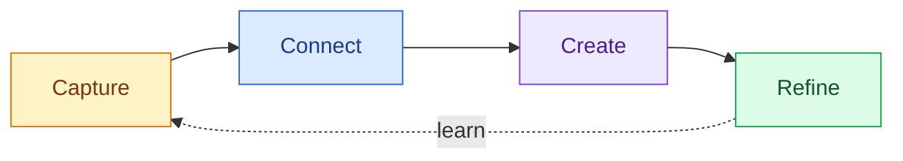

# Make space for your best ideas

> **Welcome to Daftar.** A quiet place for rough thoughts, clear plans, useful code, and the diagrams that connect them.

Great notes do not need a complicated system. Start with a sentence, shape it with **strong ideas**, add a little *emphasis*, and ~~remove what no longer matters~~. Everything stays in portable Markdown.

## Today, at a glance

- [x] Capture the idea before it disappears
- [x] Turn the messy parts into a simple map
- [ ] Share the first draft when it is useful, not perfect

### A small creative loop



> "The palest ink is better than the best memory."
>
> Keep the raw thought. You can always make it elegant later.

---

## Plan with just enough structure

| Focus | Next move | Signal |
| :--- | :--- | ---: |
| Product | Sketch the smallest useful version | 80% |
| Craft | Protect one distraction-free hour | 60 min |
| Learning | Write down one surprising thing | 1 insight |

1. **Collect** fragments without judging them.
2. **Connect** related ideas.
   - Link the question to the evidence.
   - Keep assumptions close to the decision.
3. **Create** something concrete.

Need to find this later? Search for `creative loop`, the notebook name, or any phrase in the note. [Markdown is designed to stay readable](https://www.markdownguide.org/) even outside the app.

## Keep code beside the thinking

Inline snippets like `startTransition(() => save(note))` stay crisp, while fenced blocks get full syntax highlighting:

```typescript
type Idea = {
    spark: string;
    energy: "quiet" | "electric";
};

const makeSomething = ({ spark, energy }: Idea) => {
    return energy === "electric" ? `${spark} - ship it.` : `${spark} - let it steep.`;
};
```

### Draw what words cannot

```excalidraw
{
  "type": "excalidraw",
  "id": "daftar-showcase-drawing",
  "version": 2,
  "source": "daftar",
  "elements": [
    {
      "id": "canvas",
      "type": "rectangle",
      "x": 40,
      "y": 35,
      "width": 760,
      "height": 310,
      "angle": 0,
      "strokeColor": "#1e1e1e",
      "backgroundColor": "#f8f9fa",
      "fillStyle": "solid",
      "strokeWidth": 2,
      "strokeStyle": "solid",
      "roughness": 1,
      "opacity": 100,
      "groupIds": [],
      "frameId": null,
      "roundness": { "type": 3 },
      "seed": 101,
      "version": 1,
      "versionNonce": 101,
      "isDeleted": false,
      "boundElements": [],
      "updated": 1,
      "link": null,
      "locked": false
    },
    {
      "id": "spark",
      "type": "ellipse",
      "x": 95,
      "y": 130,
      "width": 125,
      "height": 125,
      "angle": 0,
      "strokeColor": "#d97706",
      "backgroundColor": "#fef3c7",
      "fillStyle": "solid",
      "strokeWidth": 3,
      "strokeStyle": "solid",
      "roughness": 1,
      "opacity": 100,
      "groupIds": [],
      "frameId": null,
      "roundness": { "type": 2 },
      "seed": 202,
      "version": 1,
      "versionNonce": 202,
      "isDeleted": false,
      "boundElements": [],
      "updated": 1,
      "link": null,
      "locked": false
    },
    {
      "id": "shape",
      "type": "diamond",
      "x": 355,
      "y": 130,
      "width": 125,
      "height": 125,
      "angle": 0,
      "strokeColor": "#2563eb",
      "backgroundColor": "#dbeafe",
      "fillStyle": "solid",
      "strokeWidth": 3,
      "strokeStyle": "solid",
      "roughness": 1,
      "opacity": 100,
      "groupIds": [],
      "frameId": null,
      "roundness": { "type": 2 },
      "seed": 303,
      "version": 1,
      "versionNonce": 303,
      "isDeleted": false,
      "boundElements": [],
      "updated": 1,
      "link": null,
      "locked": false
    },
    {
      "id": "share",
      "type": "ellipse",
      "x": 615,
      "y": 130,
      "width": 125,
      "height": 125,
      "angle": 0,
      "strokeColor": "#7c3aed",
      "backgroundColor": "#ede9fe",
      "fillStyle": "solid",
      "strokeWidth": 3,
      "strokeStyle": "solid",
      "roughness": 1,
      "opacity": 100,
      "groupIds": [],
      "frameId": null,
      "roundness": { "type": 2 },
      "seed": 404,
      "version": 1,
      "versionNonce": 404,
      "isDeleted": false,
      "boundElements": [],
      "updated": 1,
      "link": null,
      "locked": false
    },
    {
      "id": "arrow-one",
      "type": "arrow",
      "x": 235,
      "y": 192,
      "width": 100,
      "height": 0,
      "angle": 0,
      "strokeColor": "#495057",
      "backgroundColor": "transparent",
      "fillStyle": "solid",
      "strokeWidth": 3,
      "strokeStyle": "solid",
      "roughness": 1,
      "opacity": 100,
      "groupIds": [],
      "frameId": null,
      "roundness": { "type": 2 },
      "seed": 505,
      "version": 1,
      "versionNonce": 505,
      "isDeleted": false,
      "boundElements": [],
      "updated": 1,
      "link": null,
      "locked": false,
      "points": [[0, 0], [100, 0]],
      "lastCommittedPoint": null,
      "startBinding": null,
      "endBinding": null,
      "startArrowhead": null,
      "endArrowhead": "arrow"
    },
    {
      "id": "arrow-two",
      "type": "arrow",
      "x": 495,
      "y": 192,
      "width": 100,
      "height": 0,
      "angle": 0,
      "strokeColor": "#495057",
      "backgroundColor": "transparent",
      "fillStyle": "solid",
      "strokeWidth": 3,
      "strokeStyle": "solid",
      "roughness": 1,
      "opacity": 100,
      "groupIds": [],
      "frameId": null,
      "roundness": { "type": 2 },
      "seed": 606,
      "version": 1,
      "versionNonce": 606,
      "isDeleted": false,
      "boundElements": [],
      "updated": 1,
      "link": null,
      "locked": false,
      "points": [[0, 0], [100, 0]],
      "lastCommittedPoint": null,
      "startBinding": null,
      "endBinding": null,
      "startArrowhead": null,
      "endArrowhead": "arrow"
    },
    {
      "id": "spark-label",
      "type": "text",
      "x": 121,
      "y": 177,
      "width": 73,
      "height": 30,
      "angle": 0,
      "strokeColor": "#78350f",
      "backgroundColor": "transparent",
      "fillStyle": "solid",
      "strokeWidth": 1,
      "strokeStyle": "solid",
      "roughness": 1,
      "opacity": 100,
      "groupIds": [],
      "frameId": null,
      "roundness": null,
      "seed": 707,
      "version": 1,
      "versionNonce": 707,
      "isDeleted": false,
      "boundElements": [],
      "updated": 1,
      "link": null,
      "locked": false,
      "fontSize": 24,
      "fontFamily": 1,
      "text": "SPARK",
      "textAlign": "center",
      "verticalAlign": "middle",
      "containerId": null,
      "originalText": "SPARK",
      "autoResize": true,
      "lineHeight": 1.25
    },
    {
      "id": "shape-label",
      "type": "text",
      "x": 381,
      "y": 177,
      "width": 73,
      "height": 30,
      "angle": 0,
      "strokeColor": "#1e3a8a",
      "backgroundColor": "transparent",
      "fillStyle": "solid",
      "strokeWidth": 1,
      "strokeStyle": "solid",
      "roughness": 1,
      "opacity": 100,
      "groupIds": [],
      "frameId": null,
      "roundness": null,
      "seed": 808,
      "version": 1,
      "versionNonce": 808,
      "isDeleted": false,
      "boundElements": [],
      "updated": 1,
      "link": null,
      "locked": false,
      "fontSize": 24,
      "fontFamily": 1,
      "text": "SHAPE",
      "textAlign": "center",
      "verticalAlign": "middle",
      "containerId": null,
      "originalText": "SHAPE",
      "autoResize": true,
      "lineHeight": 1.25
    },
    {
      "id": "share-label",
      "type": "text",
      "x": 640,
      "y": 177,
      "width": 75,
      "height": 30,
      "angle": 0,
      "strokeColor": "#4c1d95",
      "backgroundColor": "transparent",
      "fillStyle": "solid",
      "strokeWidth": 1,
      "strokeStyle": "solid",
      "roughness": 1,
      "opacity": 100,
      "groupIds": [],
      "frameId": null,
      "roundness": null,
      "seed": 909,
      "version": 1,
      "versionNonce": 909,
      "isDeleted": false,
      "boundElements": [],
      "updated": 1,
      "link": null,
      "locked": false,
      "fontSize": 24,
      "fontFamily": 1,
      "text": "SHARE",
      "textAlign": "center",
      "verticalAlign": "middle",
      "containerId": null,
      "originalText": "SHARE",
      "autoResize": true,
      "lineHeight": 1.25
    }
  ],
  "appState": {
    "viewBackgroundColor": "#ffffff",
    "gridSize": null
  },
  "files": {}
}
```

The drawing is not a static image. Select **Edit drawing** to reopen it, or type `/draw` on an empty line to make another canvas.

---

## Built to disappear while you work

- Switch between **Edit**, **Preview**, and **Split** views.
- Drag the split to give words or preview more room.
- Enter **Focus mode** when the sidebars can wait.
- Choose normal editing or **Vim keybindings**.
- Move between light and dark themes without redrawing diagrams.
- Trust **autosave**, and use fuzzy search when memory fails.

#### A note to your future self

Small notes compound. Capture the useful detail today; tomorrow-you will know what to do with it.

##### Portable by default

This entire page is plain text: headings, lists, tables, links, code, and diagrams included.

###### End of the tour

Now rename this note, make a fresh one, and turn the blank page into something only you could write.
